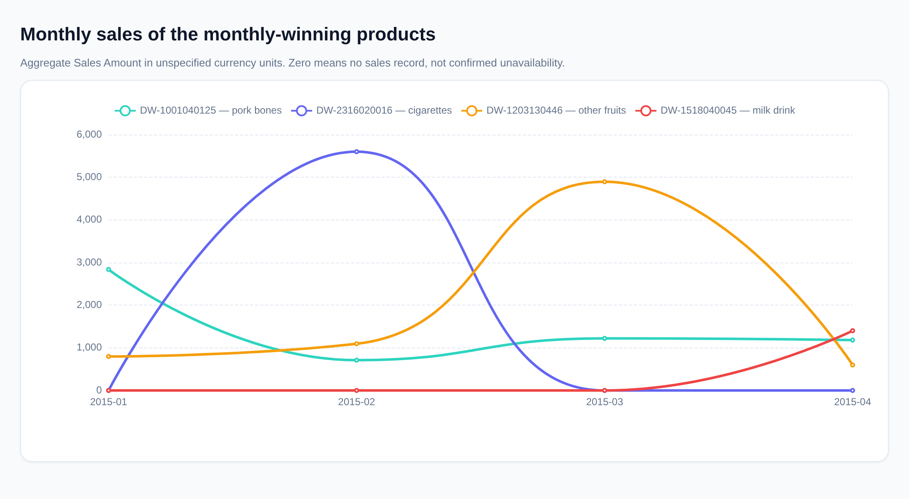
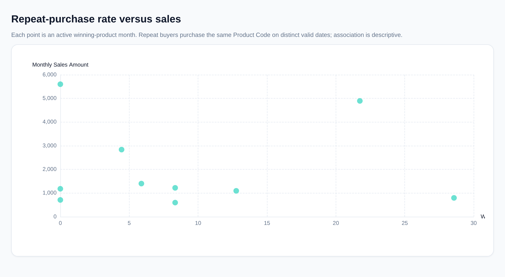

# Monthly Product Sales Leaders and Repurchase Analysis

## Executive findings

- **A different product led each month** from January through April 2015.
- Among these monthly winners, **`DW-1203130446` — “Other fruits” — generated the highest total sales, 7,384.83, and the highest observed repurchase rate, 25.99%.**
- **High sales did not consistently imply high repurchasing.** February’s cigarette leader generated 5,600.00 from only two buyers, with no observed repeat purchases. Across the winning products’ active months, the correlation between within-month repurchase rate and monthly Sales Amount was **−0.025**.

## Scope and assumptions

The analysis uses `sheet1`, containing **42,816 rows and 6,142 Product Codes**, with total Sales Amount of **457,390.39** across January–April 2015.

- **Monthly sales:** the sum of `Sales Amount` for each `Product Code` within `Sales Month`, rather than the largest individual sales line.
- **Product descriptions:** the dataset provides category and specification fields, not exact product names. Category descriptions are used below.
- **Monetary units:** the currency is unspecified.
- **Repurchase:** the same customer purchases the same Product Code on **at least two distinct valid dates**. Multiple lines on the same date do not establish a repeat purchase.
- Repurchase calculations use positive-sales rows with valid dates and positive customer identifiers. Customer ID zero is conservatively treated as unidentified.

## Monthly sales leaders

| Month | Product Code | Category description | Highest monthly Sales Amount | Share of all sales that month |
|---|---|---|---:|---:|
| January 2015 | **DW-1001040125** | Pork bones | **2,836.46** | 2.41% |
| February 2015 | **DW-2316020016** | Domestic cigarettes, out-of-province | **5,600.00** | 3.97% |
| March 2015 | **DW-1203130446** | Other fruits | **4,893.62** | 5.16% |
| April 2015 | **DW-1518040045** | Tetra Pak brick acidified milk drink | **1,400.30** | 1.35% |

There were **no ties** for the monthly maximum.

## How the winning products performed across months

Each cell shows **Sales Amount (rank among all products that month)**. Totals cover the entire observed period.

| Product Code | January | February | March | April | Period total |
|---|---:|---:|---:|---:|---:|
| DW-1203130446 — Other fruits | 797.79 (14) | 1,095.26 (12) | **4,893.62 (1)** | 598.16 (17) | **7,384.83** |
| DW-1001040125 — Pork bones | **2,836.46 (1)** | 711.01 (23) | 1,220.88 (3) | 1,180.53 (4) | **5,948.88** |
| DW-2316020016 — Cigarettes | 0.00 (—) | **5,600.00 (1)** | 0.00 (—) | 0.00 (—) | **5,600.00** |
| DW-1518040045 — Milk drink | 0.00 (—) | 0.00 (—) | 0.00 (—) | **1,400.30 (1)** | **1,400.30** |

*Zero means no sales record for that product-month. It does not establish that the product was unavailable.*

### Product-level interpretation

- **Other fruits:** Sales rose **346.80%** from February to March, then fell **87.78%** in April. Buyer counts moved from **47 to 161 to 24** over those months. This was a pronounced sales spike, not sustained growth.
- **Pork bones:** January leadership was followed by a **74.93%** sales decline in February. The product subsequently recovered to monthly ranks **3 and 4** in March and April, showing continued sales presence beyond its winning month.
- **Cigarettes:** All recorded sales occurred in February. The total came from **two sales lines**, worth **4,200.00 and 1,400.00**, belonging to different customers. This is a concentrated high-value sales result rather than evidence of repeat demand.
- **Milk drink:** Sales were recorded only in April, involving **34 buyers**. The data cannot establish whether its absence earlier reflects availability, assortment changes, or limited observation.

## Repurchase rates and their relationship with sales

### Full-period repurchase

The full-period rate is:

**Customers buying the product on multiple distinct dates ÷ all eligible customers buying that product.**

| Product Code | Distinct buyers | Repeat buyers | Repurchase rate | Share of sales from repeat buyers |
|---|---:|---:|---:|---:|
| DW-1203130446 — Other fruits | 227 | 59 | **25.99%** | **52.02%** |
| DW-1001040125 — Pork bones | 104 | 11 | **10.58%** | **18.87%** |
| DW-2316020016 — Cigarettes | 2 | 0 | **0.00%** | **0.00%** |
| DW-1518040045 — Milk drink | 34 | 2 | **5.88%** | **9.09%** |

*Sales from repeat buyers include those customers’ initial purchases—not only their subsequent purchases.*

The fruit product has the strongest observed repeat-customer contribution. However, the products have unequal observation opportunities: fruit and pork bones have sales throughout the period, whereas cigarettes and the milk drink appear in only one month.

### Within-month repurchase

To compare sales and repurchasing over matching time intervals, the following rates count repeat purchases **within each month**.

| Product Code | January | February | March | April |
|---|---:|---:|---:|---:|
| DW-1203130446 — Other fruits | 28.57% | 12.77% | 21.74% | 8.33% |
| DW-1001040125 — Pork bones | 4.44% | 0.00% | 8.33% | 0.00% |
| DW-2316020016 — Cigarettes | — | 0.00% | — | — |
| DW-1518040045 — Milk drink | — | — | — | 5.88% |

*— indicates no recorded buyers, so the rate is undefined rather than zero.*

The relationship depends substantially on the level of aggregation:

| Comparison | Observations | Pearson correlation: repurchase rate vs. Sales Amount |
|---|---:|---:|
| Full-period totals across the winning products | 4 products | 0.550 |
| Within-month rates versus monthly sales, all active winning-product months | 10 product-months | **−0.025** |
| Other fruits, across months | 4 months | 0.294 |
| Pork bones, across months | 4 months | 0.338 |

**Interpretation:** The positive full-period association does not translate into a consistent monthly relationship. For example, fruit’s highest repurchase rate was **28.57% in January**, but its highest sales occurred in March, when its repurchase rate was **21.74%**.

Buyer counts tracked monthly sales more closely than repurchase rates did: their sales correlations were **0.998 for fruit** and **0.973 for pork bones**. This suggests that changes in customer reach were more closely associated with these products’ sales fluctuations, although it does not establish causation.

### Did customers return in the following month?

Next-month repurchase measures the proportion of a month’s buyers who bought the **same product in the immediately following calendar month**.

| Product Code | January → February | February → March | March → April |
|---|---:|---:|---:|
| DW-1203130446 — Other fruits | 5/28 = **17.86%** | 12/47 = **25.53%** | 10/161 = **6.21%** |
| DW-1001040125 — Pork bones | 0/45 = **0.00%** | 1/15 = **6.67%** | 1/24 = **4.17%** |
| DW-2316020016 — Cigarettes | — | 0/2 = **0.00%** | — |

The fruit product’s March sales surge was followed by limited observed retention: only **10 of its 161 March buyers** purchased it again in April. The milk drink’s next-month retention cannot be assessed because the dataset ends in April.

## Limitations and robustness

- **Data quality:** There are **2 rows** with the invalid date `20150229`, **5 rows** with Customer ID zero, and **8 zero-sales rows**. The repurchase eligibility filter excludes **15 rows**; none belongs to the winning products.
- **Duplicate sensitivity:** The dataset contains **83 excess exact-duplicate rows**. Raw rows were retained because matching rows cannot be proven erroneous without an order identifier. Removing exact duplicates leaves **all monthly winning Product Codes unchanged**; March fruit sales become **4,884.08**.
- **Limited inference:** The short observation period, small number of winning products, unequal sales histories, and selection of products because they won a month prevent strong statistical or causal conclusions. No-record months do not prove stockouts, launches, or discontinuations.

## Conclusion

**Monthly sales leadership reflects different demand patterns, not a uniform loyalty effect.** The fruit product combines the strongest observed repeat purchasing with the largest period total among the monthly winners, but its March peak was not sustained. Pork bones maintained a stronger subsequent sales ranking despite modest repurchasing. Cigarette leadership was driven by a small number of high-value buyers, while the milk drink lacks follow-up history.

For decision-making, track **Sales Amount, buyer counts, within-month repeat rates, and next-month retention together** rather than treating a high-sales month as evidence of durable customer loyalty.

*Query evidence: monthly maxima and shares—`queries/q_021.sql`; cross-month sales and ranks—`queries/q_018.sql`; full-period repurchase—`queries/q_019.sql`; monthly rates and sales changes—`queries/q_022.sql`; next-month retention—`queries/q_023.sql`; correlations—`queries/q_012.sql` and `queries/q_020.sql`; quality and sensitivity—`queries/q_003.sql`, `queries/q_005.sql`, and `queries/q_011.sql`.*
