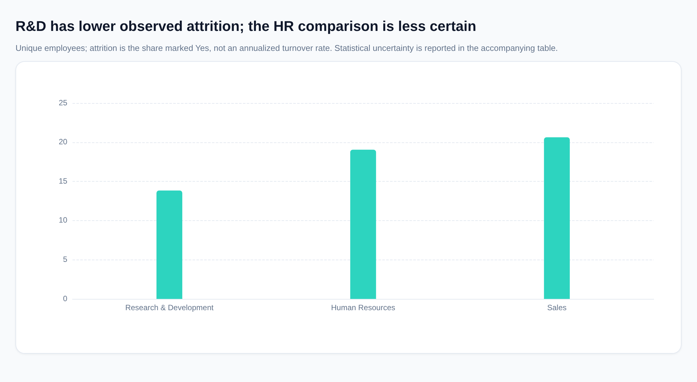
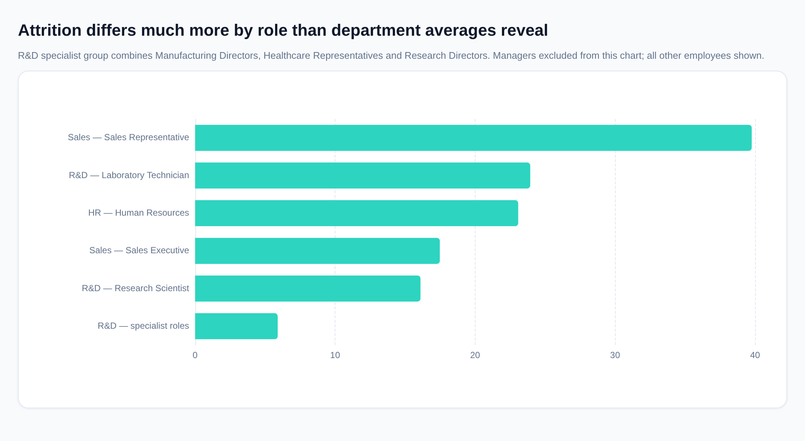

# Why is attrition lower in Research & Development?

## Executive conclusion

**R&D’s lower attrition is most clearly associated with its occupational mix—not with less overtime, higher pay, longer tenure, or uniformly better employee satisfaction.** R&D contains a substantial group of low-attrition specialist roles, whereas Sales Representatives have particularly high attrition.

However, job roles are almost entirely department-specific, so the data cannot cleanly separate an occupational effect from a department effect. The findings identify **retention patterns and investigation priorities, not proven causes**.

The premise also needs qualification: **R&D’s difference from Sales is statistically supported; its difference from HR is not conclusive.**

## Establishing the department gap

| Department | Employees | Employees marked as attrited | Attrition rate | 95% confidence interval |
|---|---:|---:|---:|---:|
| Research & Development | 961 | 133 | **13.84%** | 11.80%–16.17% |
| Human Resources | 63 | 12 | **19.05%** | 11.25%–30.41% |
| Sales | 446 | 92 | **20.63%** | 17.13%–24.63% |

- **Sales versus R&D:** a **6.79 percentage-point** difference, with an approximate difference interval of **2.44–11.13 percentage points**. The two-sided Fisher exact test gives **p = 0.001716**.
- **HR versus R&D:** a **5.21 percentage-point** difference, but the approximate interval is **−4.73 to 15.15 percentage points**, with **p = 0.262066**. HR’s small sample leaves considerable uncertainty.

These tests assume independent employee observations; they do not establish causation.

## Occupational mix is the strongest descriptive explanation

### R&D includes a sizable low-attrition specialist group

Manufacturing Directors, Healthcare Representatives, and Research Directors together account for:

- **356 employees**, or **37.04%** of R&D.
- **21 departures**, giving an attrition rate of **5.90%**.

These roles pull down R&D’s department average. Its other substantial occupational groups have higher attrition:

| R&D occupational group | Employees | Departures | Attrition rate |
|---|---:|---:|---:|
| Specialist roles listed above | 356 | 21 | **5.90%** |
| Research Scientists | 292 | 47 | **16.10%** |
| Laboratory Technicians | 259 | 62 | **23.94%** |

### Sales Representatives disproportionately raise Sales attrition

Sales Representatives have **33 departures among 83 employees**, an attrition rate of **39.76%**. They represent **18.61%** of Sales employees but **35.87%** of Sales departures.

Sales Executives, by comparison, have **17.48%** attrition.

### Descriptive exclusion checks show the importance of these concentrations

- Excluding Sales Representatives lowers the remaining Sales attrition rate to **16.25%**. This reduces the observed Sales–R&D gap by **64.44%**.
- Excluding the low-attrition specialist group raises the remaining R&D attrition rate to **18.51%**.

**These are arithmetic sensitivity checks, not estimates of what an intervention would achieve.** They change the population being compared, are not additive, and partly rely on grouping roles after observing their attrition rates.

Crucially, **Manager is the only job role shared across departments**. Consequently, the dataset cannot show whether R&D would retain the same employees better if they were doing the same jobs elsewhere.

## Overtime and other risk factors matter—but their prevalence does not explain most of the gap

The following exposures identify higher-risk groups. Nevertheless, their workforce shares are similar in R&D and Sales.

| Exposure | R&D workforce exposed | Sales workforce exposed | Attrition among exposed: R&D | Attrition among exposed: Sales |
|---|---:|---:|---:|---:|
| Reports overtime | 28.20% | 28.70% | 27.31% | 37.50% |
| Travels frequently | 18.94% | 18.83% | 20.33% | 33.33% |
| Company tenure up to two years | 23.52% | 23.09% | 26.55% | 34.95% |
| No stock options | 42.35% | 44.17% | 20.64% | 32.49% |
| Lowest job-satisfaction rating | 19.98% | 19.28% | 19.79% | 26.74% |

**The distinction is between a factor associated with individual attrition and a factor explaining the department difference.**

For example, overtime is strongly associated with attrition:

- In R&D, attrition is **27.31%** with overtime versus **8.55%** without.
- In Sales, it is **37.50%** with overtime versus **13.84%** without.

But overtime is not materially less common in R&D. The department advantage appears **within both overtime categories**, rather than mainly resulting from different overtime prevalence. Similar reasoning applies to early tenure, travel, stock-option eligibility, and low satisfaction.

Those within-group differences may still reflect occupational mix and other confounding—not necessarily better R&D management or working conditions.

## Adjusting workforce mix does not remove R&D’s advantage

I standardized the departments to the same pooled workforce distribution, applying each department’s within-group attrition rates to common weights.

Each adjustment below is separate, except the joint job-level-and-overtime adjustment.

| Comparison | Standardized R&D attrition | Standardized Sales attrition | Sales minus R&D |
|---|---:|---:|---:|
| Observed, unadjusted | 13.84% | 20.63% | **6.79 pp** |
| Same overtime mix | 13.87% | 20.55% | **6.68 pp** |
| Same age-band mix | 13.82% | 20.75% | **6.93 pp** |
| Same company-tenure mix | 13.78% | 20.87% | **7.09 pp** |
| Same income-band mix | 12.88% | 21.83% | **8.95 pp** |
| Same job-level and overtime mix | 12.32% | 25.54% | **13.22 pp** |

All R&D and Sales employees are represented in these displayed comparisons, although some joint strata are small.

### Pay and seniority actually mask part of the difference

R&D does **not** have an obviously more favorable compensation or seniority profile:

- Mean monthly income is **6,281.25** in R&D versus **6,959.17** in Sales, in the dataset’s recorded monetary units.
- Mean company tenure is **6.86 years** versus **7.28 years**.
- Job Level 1 employees constitute **45.16%** of R&D versus **17.04%** of Sales. Within that level, attrition is **23.27%** versus **42.11%**.

Thus, standardizing income or job level widens rather than closes the gap. This suggests Sales’ more favorable aggregate mix is suppressing some of its higher within-group attrition.

A broad satisfaction advantage is also not evident: mean job satisfaction is **2.73** in R&D versus **2.75** in Sales, while mean work-life balance is **2.73** versus **2.82**.

These standardized results remain descriptive. Job levels may represent different work across occupations, and this is not a fully adjusted causal model.

## HR: plausible concentrations, but insufficient evidence for a firm driver ranking

HR has a greater concentration of Job Level 1 employees: **52.38%**, compared with **45.16%** in R&D.

Its departures are also concentrated:

- All **12 HR departures** occur in the Human Resources job role, which has **52 employees** and **23.08%** attrition.
- Employees with company tenure up to two years have **6 departures among 13 employees**, or **46.15%** attrition.
- Employees with the lowest job-satisfaction rating have **5 departures among 11 employees**, or **45.45%** attrition.

These are useful investigation leads, but the groups are small and overlap. They cannot be added together or treated as reliable causal explanations of the HR–R&D difference.

## Recommended priorities

| Priority | Evidence | Recommended response |
|---|---|---|
| **Investigate Sales Representative retention, especially overtime** | Representatives reporting overtime have **16 departures among 24 employees: 66.67%** attrition. | Review staffing, workload, targets, earnings predictability, onboarding, and manager support. Treat these as hypotheses to test. |
| **Do not assume all R&D roles are low-risk** | Scientists and technicians account for **109 of R&D’s 133 departures: 81.95%**. Laboratory Technicians reporting overtime have **31 departures among 62 employees: 50.00%** attrition; Research Scientists reporting overtime have **33 among 97: 34.02%**. | Prioritize role-specific workload and career-path diagnostics rather than relying on the favorable department average. |
| **Investigate early-tenure and dissatisfied HR employees** | Departures are concentrated in these small, overlapping groups. | Use stay interviews and exit-reason reviews to identify recurring issues before choosing an intervention. |
| **Understand the low-attrition R&D specialist roles** | Their combined attrition is **5.90%**. | Investigate what distinguishes their work, career paths, staffing, and rewards—but validate whether those practices are transferable. |

## Data treatment and limitations

- The source contains **1,480 rows but 1,470 unique employees**. I removed **10 excess duplicate records**. Duplicate records conflict on manager tenure for **3 employees**, so that field was excluded rather than arbitrarily selected.
- No employees were missing the main fields checked for this analysis. Employee, department, and role totals were reconciled.
- I interpret `Attrition = 'Yes'` as a departure and assume a common observation window. Because that window is unspecified, these are **attrition proportions, not annualized turnover rates**.
- Higher satisfaction codes are assumed to indicate better ratings. Currency and formal rating definitions were not supplied.
- The data do not provide departure timing or exit reasons. Role-specific external opportunities, workload intensity, incentives, and management practices remain possible explanations—not demonstrated causes.

**Bottom line:** R&D’s advantage is concentrated in particular occupations and persists within broad workforce categories. Occupational mix is the clearest observed explanation; lower exposure to overtime or a generally better-paid, longer-tenured, happier workforce is not. The most useful response is targeted investigation of high-risk roles—not a blanket conclusion that R&D’s departmental practices cause better retention.

*SQL evidence: audit and reconciliation (`queries/q_028.sql`, `queries/q_038.sql`); department rates and exact tests (`queries/q_026.sql`, `queries/q_020.sql`); occupational profiles and exclusion checks (`queries/q_031.sql`, `queries/q_032.sql`); exposure comparisons (`queries/q_029.sql`, `queries/q_030.sql`); standardization (`queries/q_027.sql`); department averages (`queries/q_033.sql`).*
