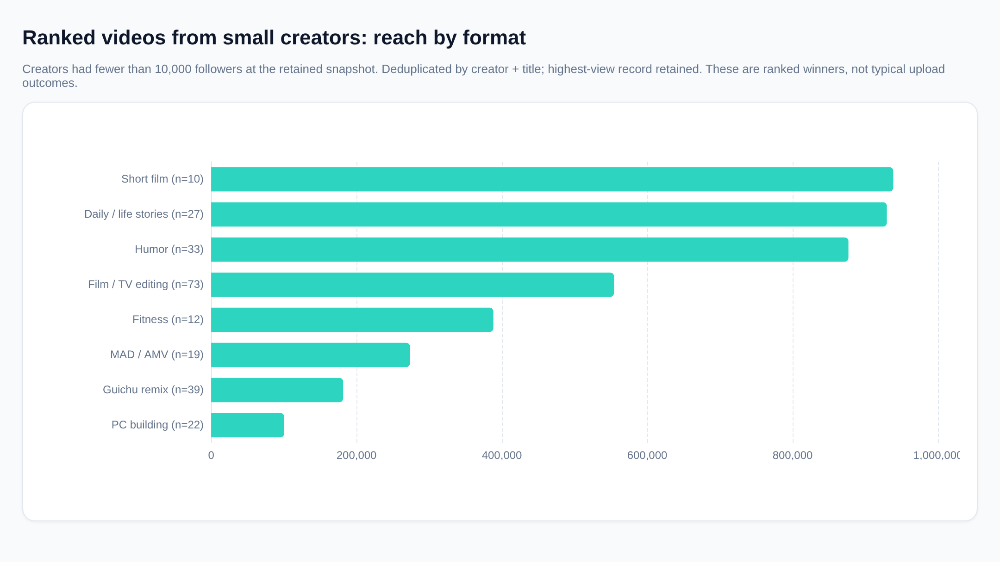
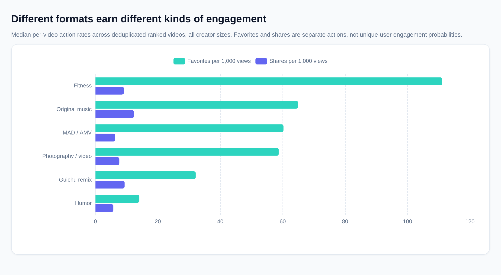

# How to make videos with better breakout potential

## The recommendation

**Start with a repeatable format built around a clear payoff: a relatable joke, an emotionally recognizable story, an impressive demonstration, or something useful enough to save.** Choose the version you can make well and keep improving—not simply the category with the biggest hit.

A large following was not universal among the winners:

- **860 videos**, or **30.52%** of the deduplicated sample, came from creators with fewer than **10,000 recorded followers**.
- **141** of those videos reached at least **1,000,000 views**.

That demonstrates that small accounts can achieve substantial reach. It does **not** establish your probability of doing so: this database contains ranked videos, not the unsuccessful uploads needed to calculate success rates.

## What I analyzed

The database contains **5,200 ranking listings** across **13 ranking sections**. Many listings are repeated observations of the same video or appearances in different sections.

I treated each **creator-and-title combination** as a video proxy, producing **2,818 distinct videos**, and retained the complete record with the highest observed views. This avoids counting repeated listings as separate successes.

**Assumptions:** “Small creator” means fewer than **10,000 followers at the retained snapshot**; “million-view breakout” means at least **1,000,000 observed views**. Neither identifies the creator’s audience size before publication.

There is no date field, so I cannot establish month-to-month trends, posting times, or how quickly the views accumulated.

## Choose a format that works for small creators—not just established stars

The following comparisons are restricted to the small-creator group.

| Format in the database | Ranked small-creator videos | Median views | Practical experiment |
|---|---:|---:|---|
| Short Film | 10 | 938,501 | A self-contained story with a clear setup and payoff |
| daily | 27 | 929,660 | A relatable experience, unusual situation, or personal challenge |
| funny | 33 | 876,809 | An immediately understandable joke, reversal, or reaction |
| Film and television editing | 73 | 554,242 | A focused emotional or thematic edit, using appropriately licensed material |
| fitness | 12 | 388,245 | A useful demonstration or routine within your expertise |

**My starting shortlist would be humor or story-led daily content**, if those match your strengths. They offer ways to test an idea using original footage without needing celebrity access or an established audience.

Editing is another plausible route if you have that skill. However, leaderboard examples are not permission to reuse copyrighted footage.

Treat the short-film result cautiously because its sample is small. More generally, these are **medians among ranked winners**, not expected views for a new upload.

### Why creator size matters

For **Guichu Remix**, the overall median was **783,530 views**, but the small-creator median was **181,590**. That does not make the format unsuitable; it shows why an overall leaderboard can be a misleading benchmark for a beginner.

**Compare yourself with creators of similar size making similar content.**

## Give viewers a reason to save or share—not merely watch

Different formats earn different kinds of engagement.

These are median per-video action rates across all creator sizes:

| Format | Favorites per 1,000 views | Shares per 1,000 views |
|---|---:|---:|
| Fitness | 111.14 | 9.11 |
| MAD·AMV | 60.27 | 6.35 |
| Guichu Remix | 32.13 | 9.33 |
| Humor | 14.08 | 5.74 |

The useful distinction is between **reach** and **reasons to return or recommend**:

- **Useful content:** Make the video easy to revisit—a routine, explanation, reference, or demonstration. Fitness’s high favorite rate makes this a worthwhile hypothesis to test.
- **Entertainment:** Build a payoff viewers can describe to someone else: “This is exactly what happens to us,” or “You need to see how this ends.”
- **Creative edits and remixes:** Give the work a distinctive concept rather than relying only on familiar source material.

These patterns do not prove that favorites or shares caused distribution. Nor are the actions counts of unique engaged people. Use them to evaluate how viewers respond, not as a formula for manipulating the recommendation system.

## Borrow the creative mechanism, not the exact topic

The low-follower breakout examples suggest several useful directions:

| Example from the rankings | Recorded followers | Views | Creative hypothesis to test |
|---|---:|---:|---|
| High-school performance of “Canon” | 2,476 | 5.24 million | Familiar material paired with visibly impressive skill |
| “Primary school student: Thank you very much” | 1,102 | 4.27 million | A recognizable social situation with comic potential |
| “Childhood Time Machine” | 3,978 | 3.87 million | Shared nostalgia and an emotionally clear premise |

These interpretations come from titles and tags; I did not inspect the footage.

For your own work, turn those mechanisms into original concepts:

- **Familiar situation + unexpected outcome:** A common frustration acted out with a surprising reversal.
- **Recognizable material + personal skill:** A performance, build, experiment, or transformation that makes your contribution obvious.
- **Shared memory + fresh perspective:** Recreate or explain something your intended audience remembers, rather than assembling unrelated nostalgic clips.

A useful concept test is: **“Who would send this to whom, and why?”** If the answer is vague, sharpen the premise before investing heavily in production.

## Make the promise clear; do not rely on title tricks

There is little reason here to treat punctuation as a growth strategy. Titles with exclamation marks had a median of **405,262 views**, versus **395,536** without them—an observational comparison affected by differences in topics and creators.

Likewise, common tags such as “funny,” editing-related tags, and platform-program tags appear among winners, but their presence does not establish that adding them increases reach.

My practical recommendation is to:

- Write a title that communicates the situation, benefit, or curiosity clearly.
- Make the opening deliver evidence of that promise rather than unrelated introduction.
- Use accurate topic tags; do not attach unrelated trends.
- Treat title and opening changes as experiments, not established findings from this dataset.

The database does not contain thumbnails, impressions, click-through rates, or retention, so it cannot identify the best thumbnail style or prove which opening holds attention.

## A practical testing routine

**Choose a repeatable promise.** For example: relatable comedy, surprising everyday stories, or useful demonstrations in an area you know. Avoid changing your entire audience and format after every upload.

**Vary a specific creative element.** Test the premise, framing, opening, or payoff while keeping the broader format recognizable. This makes the result easier to learn from.

**Compare performance at a consistent age after publication.** Otherwise, older uploads have more opportunity to accumulate views.

**Track reach and response separately:**

- Views for reach.
- Favorites and shares per **1,000 views** for normalized response.
- Retention, completion, and follower conversion from your own creator analytics, where available.

**Repeat the underlying idea when it improves your own baseline.** Look for concepts that perform well repeatedly, rather than assuming an isolated spike is a dependable strategy. Collect evidence from your ordinary uploads as well as your hits.

## Important limits

- **Winner-only sample:** The analysis identifies patterns among ranked videos, not causal drivers or viral probabilities.
- **Balanced ranking sections:** Each section contains **400 listings**. Listing volume therefore cannot tell us which category has the most demand or least competition.
- **Imperfect video identity:** Creator-and-title matching can merge different videos with identical titles or miss renamed videos.
- **Snapshot metrics:** Captured follower counts are not necessarily pre-publication counts; views are not necessarily unique viewers.
- **Missing timing and exposure:** The data cannot justify an ideal video length, upload frequency, posting hour, or claim that a historical topic is trending now.

As a robustness check, retaining the lowest-view observation instead left the small-creator count and million-view breakout count unchanged.

**Bottom line:** Make something a specific audience can immediately understand and has a clear reason to finish, save, or send. For a beginner, the strongest starting hypotheses here are relatable humor, story-led everyday content, and useful demonstrations—not follower chasing, tag stuffing, or copying the largest creator’s format.

*SQL evidence: scope and quality — `queries/q_026.sql`; small-creator totals — `queries/q_012.sql`; format comparisons — `queries/q_009.sql`, `queries/q_011.sql`, `queries/q_027.sql`; engagement — `queries/q_023.sql`; examples — `queries/q_021.sql`; title patterns — `queries/q_016.sql`; snapshot sensitivity — `queries/q_018.sql`.*
