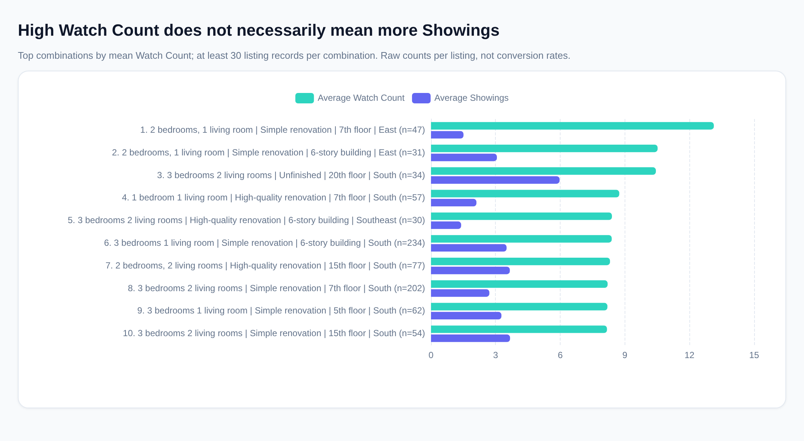

# Which homes attract attention—and which receive Showings?

## Executive findings

- **The strongest well-supported Watch Count combination** is **2 bedrooms / 1 living room, Simple renovation, “7th floor,” East-facing**: average Watch Count **13.13** across **47 listings**, versus **5.85** market-wide. However, its average Showings is only **1.51**, below the market average of **2.82**.
- A stronger combination for **both attention and Showings** is **3 bedrooms / 2 living rooms, Unfinished, “20th floor,” South-facing**: average Watch Count **10.44** and Showings **5.97** across **34 listings**.
- **Attention is not the same as viewing demand.** Watch Count and Showings have a weak overall correlation of **0.083**. After accounting for other recorded characteristics and Location, **Floor Plan and Decoration show clearer Showings associations than Floor or Orientation**.

## Scope and approach

The supplied dataset contains **29,975 listing records**. Average Watch Count is **5.85**, with a median of **3**; average Showings is **2.82**, with a median of **1**. **30.53%** of records have no Showings.

I interpret “higher Watch Count” as **higher average Watch Count per listing**, rather than total Watch Count, which would favor combinations with more inventory.

There are **3,551** complete feature combinations, and **47.03%** are represented by a single listing. Consequently, I provide:

- A **minimum-support top 10**, requiring **30 listings** per combination, as the more useful market-segment comparison.
- The **literal unrestricted top 10** later in the report, so sparse but highly watched combinations remain visible.

**Floor-label assumption:** the source mixes labels such as “6-story building” and “7th floor.” Rankings preserve these labels verbatim; they should not automatically be interpreted as the apartment’s actual story.

## Top 10 combinations with meaningful sample support

Ranked by **unrounded mean Watch Count**, among combinations with at least **30 listings**.

*BR = bedrooms; LR = living rooms. “High-quality” means High-quality renovation; “Simple” means Simple renovation.*

| Rank | Floor Plan | Decoration | Floor, as recorded | Orientation | Listings | Avg. Watch Count | Median Watch Count | Avg. Showings |
|---:|---|---|---|---|---:|---:|---:|---:|
| 1 | 2 BR / 1 LR | Simple | 7th floor | East | 47 | 13.13 | 8 | 1.51 |
| 2 | 2 BR / 1 LR | Simple | 6-story building | East | 31 | 10.52 | 4 | 3.06 |
| 3 | 3 BR / 2 LR | Unfinished | 20th floor | South | 34 | 10.44 | 4.5 | 5.97 |
| 4 | 1 BR / 1 LR | High-quality | 7th floor | South | 57 | 8.74 | 6 | 2.11 |
| 5 | 3 BR / 2 LR | High-quality | 6-story building | Southeast | 30 | 8.40 | 4.5 | 1.40 |
| 6 | 3 BR / 1 LR | Simple | 6-story building | South | 234 | 8.39 | 5 | 3.51 |
| 7 | 2 BR / 2 LR | High-quality | 15th floor | South | 77 | 8.31 | 3 | 3.66 |
| 8 | 3 BR / 2 LR | Simple | 7th floor | South | 202 | 8.20 | 4.5 | 2.71 |
| 9 | 3 BR / 1 LR | Simple | 5th floor | South | 62 | 8.19 | 6 | 3.27 |
| 10 | 3 BR / 2 LR | Simple | 15th floor | South | 54 | 8.17 | 5 | 3.67 |

### Interpretation

- **The attention leader has a Showings gap:** its Watch Count is **124.4% above** the market mean, but Showings is **46.5% below** the market mean. This segment merits investigation into pricing, availability, listing quality, or buyer qualification—not an assumption that attention will translate into visits.
- **The unfinished, South-facing, 3 BR / 2 LR combination stands out on both measures:** Watch Count is **78.4% above** market average and Showings is **111.4% above** market average.
- **Simple renovation appears frequently:** it accounts for **6** of these leading combinations. That is descriptive evidence, not proof that changing the renovation would increase demand.
- **The cutoff matters:** raising minimum support to **50 listings** makes the **1 BR / 1 LR, High-quality, “7th floor,” South-facing** combination the leader, with mean Watch Count **8.74**. The precise ordering should therefore not be treated as a definitive market hierarchy.

## What is associated with Showings?

### Raw comparisons

Before adjusting for other characteristics:

- **Floor Plan:** 3 BR / 2 LR listings average **3.09 Showings**, compared with **2.04** for 1 BR / 1 LR and **1.86** for 5 BR / 2 LR.
- **Decoration:** average Showings are relatively close—**2.87** for Simple renovation, **2.80** for High-quality renovation, **2.82** for Unfinished, and **2.71** for Luxuriously renovated.
- **Recorded Floor:** labels with numeric values in the **25–30** band average **3.32 Showings**, versus **2.33** in the **1–6** band.
- **Orientation:** South-facing listings average **2.94 Showings**, versus **2.46** for East-facing and **2.18** for North-facing.

These comparisons mix differences in Location, price, size, listing age, and promotion.

### Adjusted comparisons

I fitted an exploratory, additive regression using **29,972 complete records**, controlling for:

- Floor Plan, Decoration, recorded-floor-number bands, and Orientation;
- log area and log price per square meter;
- log of one plus Watch Count;
- publication-age category, including a missing-date category;
- Featured status; and
- **3,237 recorded Location groups**, using Location fixed effects.

The estimates below are **adjusted differences in Showings per listing**, not causal effects. Intervals are approximate **95% confidence intervals**, clustered by Location.

| Factor comparison | Adjusted Showings difference | Confidence interval | Interpretation |
|---|---:|---:|---|
| Simple vs. High-quality renovation | +0.55 | +0.42 to +0.67 | Positive association after adjustment |
| Unfinished vs. High-quality renovation | +0.83 | +0.62 to +1.03 | Positive association after adjustment |
| Luxuriously renovated vs. High-quality renovation | −0.17 | −0.60 to +0.26 | No clear independent advantage |
| 1 BR / 1 LR vs. 3 BR / 2 LR | −0.94 | −1.28 to −0.60 | Lower Showings |
| 4 BR / 2 LR vs. 3 BR / 2 LR | −0.64 | −0.82 to −0.47 | Lower Showings |
| 5 BR / 2 LR vs. 3 BR / 2 LR | −1.06 | −1.34 to −0.77 | Lower Showings |
| Recorded floor band 25–30 vs. 1–6 | +0.07 | −0.24 to +0.39 | Raw advantage largely disappears |
| Recorded floor band 31+ vs. 1–6 | +0.08 | −0.29 to +0.44 | No clear within-Location advantage |
| East vs. South orientation | −0.08 | −0.28 to +0.13 | Small, uncertain difference |
| North vs. South orientation | −0.18 | −0.44 to +0.08 | Small, uncertain difference |

**Main implications:**

- **Floor Plan matters:** the 3 BR / 2 LR reference generally outperforms the smaller and larger layouts shown, even after controlling for area and price.
- **Decoration’s raw averages conceal composition differences:** Simple renovation and Unfinished condition have positive conditional associations despite similar unadjusted means. This does **not** justify recommending renovation removal or unfinished delivery.
- **Floor and Orientation are weaker independent signals:** much of their apparent raw advantage is absorbed by Location and other controls. They should not dominate a Showings strategy.

### Other important recorded associations

- **Featured status:** Featured listings average **7.58 Showings**, versus **2.48** for non-Featured listings. The adjusted difference is **+4.47 Showings**, with an interval of **+4.07 to +4.86**. This is a large association, but promotion may be selectively assigned to listings already expected to perform well.
- **Publication-age label:** listings labeled “3 months” average **3.70 Showings**, versus **2.25** for “1 year.” The adjusted difference is **+1.73**, with an interval of **+1.53 to +1.93**.
- **Watch Count:** despite the weak overall correlation, doubling **one plus Watch Count** is associated with **+0.57 Showings** after adjustment, with an interval of **+0.52 to +0.62**.

The requested housing attributes alone explain only **1.54%** of overall Showings variation in an additive model. They are useful segmentation inputs, but insufficient as a standalone prediction system. A log-transformed Showings check and a model excluding Watch Count retain the main renovation and larger-layout patterns.

## Literal unrestricted top 10

These are the highest average Watch Counts **without a minimum group size**. Most represent individual listings rather than established segment-level demand.

| Rank | Floor Plan | Decoration | Floor, as recorded | Orientation | Listings | Avg. Watch Count |
|---:|---|---|---|---|---:|---:|
| 1 | 2 BR / 1 LR | Simple | 8 Floors | Northwest | 1 | 111.00 |
| 2 | 2 BR / 1 LR | High-quality | 25th floor | Southwest | 1 | 95.00 |
| 3 | 2 BR / 1 LR | High-quality | 15th floor | Southwest | 1 | 79.00 |
| 4 | 3 BR / 1 LR | High-quality | 17th floor | Northwest | 1 | 76.00 |
| 5 | 3 BR / 1 LR | Unfinished | 5th floor | Southeast | 1 | 73.00 |
| 6 | 1 BR / 1 LR | High-quality | Floor 19 | East | 1 | 72.00 |
| 7 | 2 BR / 0 LR | Simple | 5th floor | Southeast | 1 | 72.00 |
| 8 | 6 BR / 3 LR | Unfinished | 9th floor | South | 1 | 67.00 |
| 9 | 2 BR / 1 LR | Unfinished | 34th floor | South | 3 | 62.67 |
| 10 | 1 BR / 1 LR | Simple | 12th floor | South | 1 | 58.00 |

## Recommendations and limitations

**For attention-oriented marketing:** test the well-supported East-facing, simply renovated 2 BR / 1 LR segments, while monitoring Showings separately.

**For Showings-oriented prioritization:** investigate the unfinished, South-facing 3 BR / 2 LR segment and compare listings within the same Location, price range, and publication-age category. Validate Featured placement through a controlled test rather than assuming its observed association is causal.

**Important limitations:**

- This is the supplied listing snapshot, not necessarily a representative sample of the entire housing market.
- Metric definitions and collection windows are undocumented. Showings exceed Watch Count in **9,558 records**, so a Watch-to-Showing conversion rate would not be defensible.
- Floor labels are semantically inconsistent, and publication ages are coarse categories.
- The analysis retains the source records, including **1 exact duplicate**. Removing it leaves all **10** supported ranking positions and values unchanged.
- Rankings are descriptive; regression intervals are exploratory and not adjusted for multiple comparisons. Unmeasured differences and selection effects remain.

*SQL evidence: baseline `q_028`; supported ranking `q_024`; unrestricted ranking `q_023`; descriptive comparisons `q_010`, `q_014`, and `q_020`; adjusted estimates and clustered intervals `q_019`; model sensitivity `q_027`; duplicate verification `q_012` and `q_026`.*
